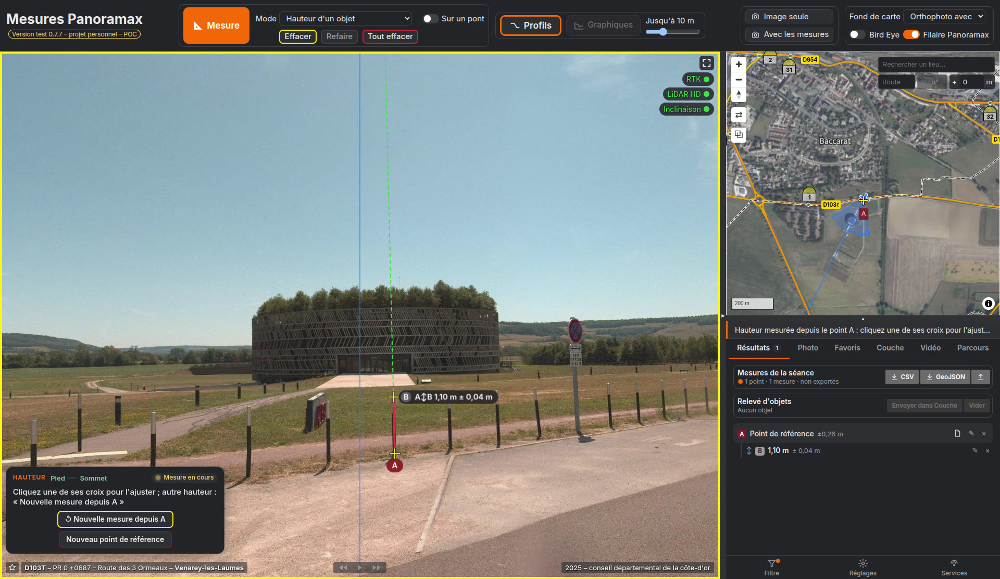

# Mesures Panoramax (web-measures)

Application web de mesure sur les photos de rue [Panoramax](https://panoramax.fr), sans
installer QGIS : hauteur d'un objet, largeur d'une chaussée, distance entre deux points, à
préparer ou vérifier depuis le bureau.

Elle reprend les calculs du plugin QGIS
[Visionneuse Panoramax](https://github.com/medlab-code/visionneuse_panoramax), validés sur
des photos imajbox 360 HD à position RTK (Pouilly-en-Auxois, Montbard, Semur-en-Auxois…).



## Principe

Toutes les mesures s'appuient sur des **points triangulés** : un même point est visé depuis
au moins deux photos, et sa position est l'intersection des visées. La profondeur vient
ainsi de la triangulation, et non plus du terrain ni de la hauteur de caméra, auxquels les
mesures sur une seule photo étaient trop sensibles.

La précision dépend donc de celle de la position et du cap des photos : les mesures sont
fiables sur des photos à **position GPS RTK vérifiée** (voyant RTK vert). Ailleurs, elles
restent possibles, mais la page prévient qu'elles seront probablement incohérentes.

## Utilisation

**Télécharger** : prendre l'archive `web-measures-X.Y.Z.zip` de la dernière version
(page *Releases* du dépôt) et la décompresser ; elle ne contient que la page et ses fichiers.

**Ouvrir la page** : double-cliquer sur `index.html` suffit (Edge, Chrome, Firefox), sans
installation ni serveur ; une connexion à internet est nécessaire (bibliothèques, Pyodide et
services). Elle peut aussi être publiée sur n'importe quel serveur web statique, ou servie
localement :

```
python3 -m http.server 8765    # puis http://127.0.0.1:8765/
```

**Première utilisation** : l'instance Panoramax de l'IGN et les photos du conseil
départemental de la Côte-d'Or sont choisies par défaut, car elles remplissent les prérequis
des mesures (précision RTK, modèle de terrain IGN : LiDAR HD, ou RGE ALTI là où il n'est pas encore publié) ; une fenêtre l'explique. On peut changer ces
réglages dans « Filtre des photos » et « Réglages », et les choix sont ensuite gardés. Une
première photo s'ouvre (Clos de Vougeot, D974), tournée vers l'ouest.

**La carte** : fonds Plan IGN, orthophoto, ortho-express, PCRS, OpenStreetMap, et
**orthophoto avec noms** : noms des lieux et des rues, voies, avec les numéros de route dans
des cartouches dessinés comme ceux de l'IISR (rouge pour les autoroutes et nationales, jaune
pour les départementales, cyan pour les métropolitaines, vert pour les européennes), limites
des départements (bleu), de la métropole (vert) et des communes (tirets noirs). Les
autoroutes et nationales paraissent dès le zoom 7, les départementales dès le zoom 10, les
autres voies dès le zoom 15. Les points de repère sont dessinés en bornes (tête à la couleur
du réseau, numéro du PR), à côté de la voie. Le filaire Panoramax, semi-transparent, se
masque par sa case à cocher.

**Choisir une photo** : cliquer sur le filaire orange de la carte (photo la plus proche) ; la
photo s'ouvre dans la visionneuse officielle Panoramax. Les flèches de la visionneuse passent
aux photos voisines, et le **lecteur de séquence** en bas de la visionneuse la fait défiler en
avant ou en arrière (chaque appui sur un sens : 1x, 2x, 4x, 8x, 16x). On peut aussi y aller
par le **requêteur route + PR**, ou coller l'**identifiant** d'une photo (ou un lien
Panoramax) dans « Aller à la photo » ; « 📋 Copier » sous l'identifiant de la photo affichée
le copie, pour la passer à un collègue.

**Mesurer** : bouton « 📐 Mesure », puis le mode. Les consignes s'affichent en haut au centre
de la visionneuse ; le bouton **« ✔ Valider le point triangulé »** y apparaît, avec un halo,
dès que les visées donnent un point (deux visées qui se croisent).

**Prise de mesure guidée** :

1. La photo de la première visée est la **photo de référence** : la mesure se fera sur elle ;
   choisir celle d'où l'objet se voit le mieux.
2. Des boutons sous la consigne proposent les photos à viser ensuite : en hauteur, la
   précédente et la suivante de la référence, puis celle de l'autre côté pour une 3e visée ;
   en largeur, en avançant vers le point. Ils sont nommés par rapport à la photo affichée
   (« photo précédente », « 2 photos en arrière »…), avec une flèche selon leur direction dans
   la vue (◀ ▶ ▲ ▼).
3. En largeur et en mesure libre, les visées déjà faites depuis les autres photos sont tracées
   en pointillés bleus dans la photo : l'objet visé est sur leur trait, il suffit de cliquer
   là où il croise la bordure. Un trait vertical au centre de la vue suit le même cap que le
   trait de la mini-carte, pour repérer dans la photo un objet vu sur la carte.
4. Après « Valider le point triangulé », la page revient sur la photo de référence et cadre la
   vue sur le point.

Une visée qui s'écarte nettement des autres est signalée (autre objet visé ?). Quand les
visées sont presque alignées et les photos RTK, le point est triangulé en 3D (inclinaison des
visées, sol LiDAR HD lu au point). Si la vérification RTK ou l'inclinaison automatique arrivent
après les clics, tout est recalculé : une mesure peut changer d'elle-même une ou deux secondes
après.

- **Hauteur d'un objet**
  1. Viser le **pied** de l'objet depuis au moins deux photos (un clic par photo, flèches
     pour changer de photo), puis « Valider le point triangulé » : c'est le point de référence,
     et le pied de la hauteur.
  2. Cliquer seulement le **sommet**, depuis une photo qui a servi à la visée : le pied est la
     visée faite depuis elle, à la profondeur du point triangulé. Depuis une autre photo,
     cliquer le pied puis le sommet.

  Une fois la hauteur faite, les clics ne servent plus qu'à l'ajuster (clic sur une de ses
  croix, puis nouveau clic sur la photo de la mesure ou flèches ↑ ↓ : 1 cm sur la verticale).
  Le point de référence se recale de même dès qu'il est validé, sur sa verticale (seule
  l'élévation du clic compte). Pour une autre hauteur depuis le même point, depuis n'importe
  quelle photo, cliquer « ↺ Nouvelle mesure depuis A » dans la visionneuse (elle repart du pied
  recalé, s'il l'a été) ; pour un autre point, « Nouveau point de référence ». Une verticale
  verte le repère dans la photo, tracée selon le calage de l'inclinaison.
- **Largeur perpendiculaire à la chaussée**
  1. Viser le **premier bord** (pied de bordure, marquage…) depuis au moins deux photos, puis
     « Valider le point triangulé ». La page trace la **droite de mesure**, perpendiculaire à l'axe de
     la route en ce point (BD TOPO, sinon trajectoire de la séquence), en bleu dans la photo
     et sur la carte.
  2. Cliquer le **bord opposé** sur la photo de référence (ou une photo prise quelques mètres
     avant ou après le point, pas juste en face) : seule la direction du clic compte, le bord
     est là où elle coupe la droite. Il reçoit la lettre suivante (B…), sur une étiquette
     grise tant qu'il n'est pas triangulé ; l'étiquette de la mesure nomme ses deux points
     (« A↔B 7,50 m ± 0,20 m »). Le sommet d'une hauteur est nommé de même (« A↕C 3,20 m »).
  3. Facultatif, plus précis : **« 🎯 Trianguler le point B »**. Le clic de l'étape 2
     compte comme première visée ; viser le même bord depuis la photo proposée, puis « Valider
     le point triangulé ». Le point garde sa lettre (étiquette bordeaux) ; la largeur devient la
     distance des deux bords triangulés,
     perpendiculaire à l'axe de la route, et la vue revient sur la photo de référence, cadrée
     sur la largeur. Pendant ces visées, les autres photos ne montrent que les visées.

  Sur une photo qui a servi à viser un bord, sa croix est là où il a été visé, et la droite
  de mesure passe par la croix du premier bord.

  Une fois la largeur faite, les clics ne servent plus qu'à l'ajuster (clic sur une de ses croix, puis nouveau clic ou flèches : 1 cm le long de la droite de mesure). Pour une autre largeur depuis le même point, cliquer « ↺ Nouvelle mesure depuis A » dans la visionneuse ; pour un autre point, « Nouveau point de référence ».

  À l'étape 2 de la hauteur et de la largeur, les flèches de la visionneuse sont masquées
  (elles gênent les clics de mesure) : on change de photo par la carte.
- **Mesure libre (points triangulés)** : viser chaque point depuis au moins deux photos, puis
  « Valider le point triangulé » ; à partir du deuxième, la distance horizontale au point précédent
  s'affiche, et la carte se cadre sur le segment.

Repères visuels :

| | Visées (triangulation) | Prise de mesure | Calage |
|---|---|---|---|
| Liseré de la visionneuse | bleu | jaune | orange |
| Étiquette animée, en haut à gauche | « Triangulation en cours » | « Mesure en cours » | — |
| Cercle du pointeur | bleu | jaune (vert si l'inclinaison est calée) | orange |
| Croix | bleues | jaunes | — |

Points, traits et étiquettes restent visibles sur toutes les photos (là où ils ont été
cliqués, ou projetés au sol sur les autres photos). Dans la photo, la droite de mesure d'une
largeur est en tirets bleus, la verticale d'une hauteur en tirets verts ; sur la carte, les
visées de triangulation sont en tirets rouges, celles du calage du cap en tirets noirs.

**Effacer** : la sélection, les visées ou la mesure en cours ; sans rien en cours, le dernier
point posé (sommet, bord opposé, puis le point de référence ; en mesure libre, le dernier
point gardé). Quand la photo affichée est à plus de 100 m des mesures, la page propose de
tout effacer pour repartir de zéro.

**Recaler un point** : **clic** (gauche ou droit) sur sa croix pour le sélectionner, puis :

- clic gauche : nouvelle position (largeur : bord ou point de référence, là où la direction
  du clic coupe la droite de mesure, dont ils ne sortent jamais ; le point de référence se
  recale ainsi dès qu'il est validé ; hauteur : sur la photo de la mesure) ;
- flèches du clavier, par pas de 1 cm : largeur, le long de la droite de mesure (← → dans le
  sens vu sur la photo, ↑ ↓ en s'éloignant ou en se rapprochant de la caméra) ; hauteur,
  ↑ ↓ montent ou descendent le point ;
- **Entrée** pour terminer.

**Caler les photos** (modes « Calage ») :

- **inclinaison** : calculée automatiquement d'après les verticales de la photo (en arrière-
  plan), ou calée à la main : pied puis sommet de deux objets verticaux, à environ 90° l'un de
  l'autre ;
- **cap et position** : un repère net cliqué dans la photo, puis sur la carte ; le premier
  corrige le cap, trois repères ou plus répartis autour de la photo recalent aussi sa
  position. La carte ne montre que les visées des repères pris depuis la photo affichée. La
  triangulation n'est jamais meilleure que le cap et la position des photos : à 20 m, 1°
  d'erreur de cap décale une visée de 35 cm.

Les consignes de chaque calage disent l'étape en cours et ce qui est déjà fait.

Le calage est gardé d'une visite à l'autre, et peut être exporté ou importé (« Réglages »).

**Autour de la mesure** :

- voyants **RTK**, **LiDAR HD** (ou **RGE ALTI** en secours) et **inclinaison** de la photo ;
- fonds de carte : Plan IGN, orthophoto, Ortho-express de l'année de la photo, PCRS de la
  Géoplateforme là où il est publié, OpenStreetMap ; recherche de lieux ; points de repère
  (PR) des routes ; requêteur route + PR (+ distance), à listes qui se réduisent à la frappe ;
- lieu de la photo incrusté en bas à gauche de la visionneuse : route, PR et distance mesurée
  le long du filaire IGN depuis le dernier PR passé, nom de la voie, commune ; hors route
  départementale, la véloroute suivie et l'écluse la plus proche (chemins de halage) ;
- lecteur de séquence (1x à 16x), date et producteur en bas à droite ;
- carte cadrée automatiquement sur la mesure en cours (mesure libre : sur le segment qui vient
  d'être mesuré) ;
- carte **détachable** dans une fenêtre à part, à placer sur un second écran (bouton « ⧉ » sous
  le zoom, Edge, Chrome et Firefox récents) : elle reste reliée à la page et se déplace à la
  souris ; fermer la fenêtre, ou
  « Remettre la carte ici » dans la colonne, la remet en place ;
- **filtre des photos** (date, type, précision GPS, producteur) et choix de l'**instance**
  Panoramax : les photos écartées ne s'ouvrent pas, ni par la carte ni par les flèches ;
- captures : vue recalculée en Full HD depuis la photo originale, ou visionneuse avec les
  mesures (PNG, copiée dans le presse-papiers) ;
- liste des résultats avec commentaire et effacement de chacun ; **export CSV**
  (point-virgule, virgule décimale) et **GeoJSON** : valeur, incertitude, composantes,
  distance à la photo, hauteur de caméra, axe de la route, photos, date, commentaire, et
  attributs des points triangulés (visées, croisement, précision GPS).

Les calculs sont ceux du plugin, exécutés dans le navigateur par Pyodide (environ 10 Mo au
premier chargement, puis en cache) ; les calculs lourds (inclinaison automatique, capture
Full HD) tournent dans un second Pyodide en arrière-plan. La page vérifie aussi l'accès aux
services depuis le poste (encart « Accès aux services »).

Pour s'ouvrir en `file://`, la page n'utilise pas de modules JavaScript ni de lecture de
fichiers voisins : scripts ordinaires, et fichiers Python regroupés dans `py/sources.js`.

## Précision

Essais sur deux photos imajbox à position RTK (±0,10 m) de Pouilly-en-Auxois, distantes de
5 m, sur des cibles connues (`tests/essai-rtk.html`, `essai-largeur.html`,
`essai-libre.html`) :

| Mesure | Résultat | Attendu |
|---|---|---|
| Point de référence (visées croisées à 54°) | ±0,17 m | sur la cible |
| Hauteur | 3,46 m ± 0,11 m | 3,464 m |
| Largeur (clic à 40° de la droite de mesure) | 8,00 m ± 0,48 m | 8 m |
| Distance entre deux points | 3,60 m ± 0,24 m | 3,606 m |

L'incertitude de la largeur vient surtout de l'axe de la route (±2° supposés pour la
BD TOPO) et de la position du point de référence le long de la route : un clic depuis une
photo plus éloignée, qui voit la droite plus en face, la réduit. Avec un GPS grand public
(±4 m), le point de référence est à plusieurs mètres près, et une hauteur à ±2 à 3 m.

### Limites

- Mesures fiables seulement sur des photos à position RTK vérifiée.
- Points projetés sur les autres photos que celle du clic : sol supposé plat, à la hauteur
  de caméra de la photo (affichage seulement, la mesure n'en dépend pas).
- Triangulation 3D validée sur des cas simulés seulement : à confirmer sur des points
  relevés sur le terrain.
- Incertitude de l'axe de la route (±2° pour la BD TOPO, ±3° pour la trajectoire) estimée,
  à confirmer sur le terrain.
- Mesures perdues en fermant la page : les exporter avant.

### Organisation

| Fichier | Rôle |
|---|---|
| `index.html`, `src/style.css` | page et mise en page |
| `src/app.js` | relie carte, visionneuse et calcul : clics, clavier, repères, liseré, filtre |
| `src/carte.js` | carte MapLibre : fonds, filaire, points de repère (PR), mesures, étiquettes, poignées, photo la plus proche |
| `src/calcul.js` | chargement de Pyodide (page et arrière-plan) et des fichiers Python (`py/sources.js`) |
| `src/services.js` | vérification de l'accès aux services |
| `src/recherche.js` | recherche de lieux sur la carte (commune, lieu-dit, voie, adresse) |
| `src/requeteur.js` | requêteur route + PR (+ distance) : routes du département affiché, côté droit par défaut |
| `src/lieu.js` | route, point de repère (PR), véloroute, écluse et commune de la photo, incrustés dans la visionneuse |
| `py/web_app.py` | application de mesure : clics → cœur de calcul → JSON pour la page (points de référence, hauteurs, largeurs, mesure libre, recalages) |
| `py/web_host.py` | accès réseau du cœur par le `fetch` du navigateur |
| `py/web_worker.py` | calculs lourds dans le Pyodide d'arrière-plan |
| `py/geoid.py` | altitude NGF (grille RAF20 de l'IGN) |
| `py/core/` | cœur de calcul du plugin, **copié** par `tools/update-core.sh` (ne pas modifier ici) ; dont `widths.py`, la largeur depuis un point triangulé |
| `py/sources.js` | fichiers Python de `py/` regroupés pour la page (généré par le même script) |
| `tests/navigateur.html` | essai de bout en bout dans un vrai navigateur |
| `tests/essai-rtk.html`, `essai-largeur.html`, `essai-libre.html` | hauteur, largeur, mesure libre sur photos RTK, avec recalages |
| `tests/inclinaison.html` | inclinaison automatique |
| `tools/serveur-essai.py` | serveur des essais : sert le site et affiche leur journal |

Mettre à jour le cœur : `tools/update-core.sh [dossier du plugin] [révision]` (par défaut
`../visionneuse_panoramax`, branche `dev`) ; la révision copiée est notée dans
`py/core/SOURCE`. À relancer aussi après toute modification d'un fichier Python sous `py/`
(il régénère `py/sources.js`).

## Choix

D'après la feuille de route du plugin (`docs/feuille-de-route.md`, 12/10/2026) :

- **Site statique** : pas d'installation sur des postes verrouillés ; les services publics
  sont appelés directement depuis le navigateur.
- Usage **au bureau** : poste fixe, grand écran, souris, connexion filaire. Pas de tablette
  ni de 4G à prévoir.
- Carte **MapLibre** : filaire Panoramax (mêmes tuiles vectorielles que le plugin), fonds de
  la Géoplateforme IGN, sans clé.
- Visionneuse officielle **`@panoramax/web-viewer`** (licence MIT) intégrée à la page.
- **Cœur de calcul en Python dans le navigateur (Pyodide)** : le même code que le plugin,
  sans portage, et ses tests restent la référence. Le téléchargement initial de Pyodide est
  acceptable au bureau.
- Interface réduite : hauteur, largeur, distance entre points ; calage seulement si
  nécessaire.
- **Indicateur de fiabilité** bien visible, d'après la vérification de la position GPS, la
  présence du LiDAR HD et le calage de l'inclinaison de la photo.
- Export CSV et GeoJSON des mesures ; base partagée plus tard.

## Accès aux services depuis le navigateur

La page liste chaque service et indique s'il répond depuis le poste (proxy, pare-feu, en-têtes
CORS). Vérifié le 13/10/2026 depuis un poste personnel, avec Chrome :

| Service | Usage | Depuis un navigateur |
|---|---|---|
| Panoramax : recherche, tuiles, photos (`api.panoramax.xyz`, `panoramax.ign.fr`) | filaire, photos, métadonnées | accessible |
| Géoplateforme IGN : WMTS | Plan IGN, orthophoto | accessible |
| Géoplateforme IGN : altimétrie | LiDAR HD, ou RGE ALTI en secours, sous les photos et au point visé (vérification de la position RTK, sol au point, inclinaison automatique) | accessible |
| Géoplateforme IGN : WMS (`wms-r`) | PCRS | accessible |
| Géoplateforme IGN : WFS | BD TOPO (axe de la route, route et PR de la photo, PR sur la carte), ADMIN EXPRESS (limites administratives) | accessible |
| Géoplateforme IGN : tuiles vectorielles (TMS) | Plan IGN (routes numérotées, noms), BD TOPO (voies) | accessible |
| Géoplateforme IGN : géocodage | recherche de lieux (autocomplétion) | accessible |
| geo.api.gouv.fr | commune de la photo | accessible |
| Stockage des photos Panoramax (S3 OVH, derrière `panoramax.ign.fr`) | photos HD : capture Full HD, inclinaison automatique | accessible |
| PROJ (`cdn.proj.org`) | grille du géoïde : altitude NGF, hauteur de caméra d'après le GPS | accessible |

**À refaire depuis le poste des utilisateurs** (proxy ou pare-feu d'entreprise) : ouvrir la page et relever la liste.

## Étapes

1. ~~Séparer le cœur de calcul de QGIS~~, dans le plugin : paquet `core/` sans import QGIS,
   services de l'hôte (réseau, altitude NGF, décodage d'image) installés par l'application.
2. ~~Maquette~~ : visionneuse officielle, cœur dans Pyodide, largeur, longueur et hauteur,
   recalage sur la carte, export CSV et GeoJSON.
3. ~~Indicateur de fiabilité, inclinaison automatique, triangulation~~ : voyants RTK, LiDAR
   HD et inclinaison, inclinaison automatique en arrière-plan, mesure libre entre points
   triangulés.
4. ~~Mesures appuyées sur un point triangulé~~ (16/10/2026) : hauteur et largeur depuis un
   point de référence, recalage au clic et au clavier ; longueur sur une seule photo
   et calage de la hauteur de caméra retirés.
5. ~~Mini-carte détachable sur un second écran~~ (ticket #13).
6. ~~Première version publiée~~ : 0.1.0 (17/10/2026).
7. Essais sur le terrain avec les agents (postes Edge, photos RTK).

## Versions

- **0.2.14** (19/10/2026) : étiquette du lieu (en bas à gauche de la visionneuse) avec la route
  et le PR de nouveau : quand la Géoplateforme refusait la requête des tronçons (requêtes en
  rafale, HTTP 429), seule la commune restait, gardée pour la session ; la description
  incomplète n'est plus gardée et elle est redemandée.
- **0.2.13** (19/10/2026) : fiche de la photo, « Précision GPS annoncée » suivie sur la même
  ligne de la précision calculée (vérification RTK sur le sol LiDAR HD ou RGE ALTI, ou pourquoi
  elle manque). Voyants RTK et LiDAR HD (ou RGE ALTI) affichés aussi hors du mode mesure ; celui
  de l'inclinaison reste en mesure. Cœur du plugin Visionneuse Panoramax (branche dev, 5f25212).
- **0.2.12** (19/10/2026) : RGE ALTI en secours là où le LiDAR HD n'est pas encore publié
  (vérification RTK, sol au point visé, inclinaison automatique ; source affichée) : plus de
  fausse alerte « GPS RTK requis » sur ces secteurs. « Sur un pont » coupe aussi le RGE ALTI.
  Sol relu au point qui converge (le point allait et venait quand le sol le déplaçait de plus
  d'1 m). Cœur du plugin Visionneuse Panoramax (branche dev, 005c49b).
- **0.2.11** (19/10/2026) : pendant la lecture de la séquence, la carte suit le tracé des
  photos image par image, à une vitesse qui ne change que progressivement (plus suivie si on la
  déplace à la main). Fenêtres « Photo sur un pont », « Sortie du pont » et « Position GPS trop
  imprécise » centrées sur la visionneuse, boutons centrés, Oui vert et Non rouge.
- **0.2.10** (19/10/2026) : pendant la lecture de la séquence, la carte glisse à vitesse
  constante d'une photo à la suivante au lieu d'avancer par à-coups (animation freinée coupée
  par chaque photo) ; lieu, PCRS et ortho-express mis à jour à l'arrêt de la lecture.
- **0.2.9** (19/10/2026) : lecture rapide de la séquence (2x à 16x) rétablie sur l'instance
  IGN : la liste des photos était demandée au stockage de ses images, qui la refuse ; elle
  l'est maintenant à l'instance (lien de la séquence, ou instance d'origine depuis le
  méta-catalogue), avec repli en lecture 1x si aucune ne répond.
- **0.2.8** (19/10/2026) : sur la carte, étiquette d'une largeur ou d'une distance posée à
  côté du trait (horizontale, perpendiculairement au trait), et non plus au-dessus de son
  milieu, où elle cachait le bord B sur un trait court ou oblique. Sortie d'un pont : case
  « Sur un pont » cochée et photo à plus de 30 m de tout pont de la BD TOPO, une fenêtre
  propose de la décocher (une fois par sortie). Cœur du plugin Visionneuse Panoramax
  (branche dev, 6939bdf).
- **0.2.7** (19/10/2026) : mesures sur un pont (ticket #16). Case « Sur un pont » dans la
  barre du haut : le LiDAR HD, qui donne le terrain sous l'ouvrage (5 à 6 m sous le tablier
  sur les ponts de la RD111 et de la RD18 au-dessus de l'A6), n'est plus utilisé ; les points
  au sol se calent sur le sol tiré des photos et l'inclinaison automatique se passe de la
  pente LiDAR. Quand la photo est sur un tronçon en pont de la BD TOPO, une fenêtre propose
  de cocher la case (une fois par pont). Cœur du plugin Visionneuse Panoramax (branche dev,
  d3e620f).
- **0.2.6** (18/10/2026) : inclinaison automatique calculée au premier clic sur la photo, et
  non plus dès son arrivée (le calcul faisait saccader la vue pendant qu'on cherchait
  l'objet). Cœur du plugin Visionneuse Panoramax (branche dev, 0c227ca).
- **0.2.5** (18/10/2026) : rotation de la vue plus fluide : cône de vue dessiné en image
  tournée sur la carte (la carte ne se redessine plus à chaque image), écartement des
  étiquettes recalculé au zoom et à l'arrêt seulement, traits de la visée à 41 points. Cœur
  du plugin Visionneuse Panoramax (branche dev, 425f5ad).
- **0.2.4** (18/10/2026) : étiquette d'une hauteur ou d'une largeur au point d'arrivée (à
  droite du sommet, sous le bord), ouverte par le nom de ce point en pastille ; étiquettes qui
  se chevauchent écartées vers le bas, l'ordre gardé, avec un trait de renvoi (photo et
  captures) ; nom posé sur le trait d'une autre mesure mis à côté ; mention « projet
  personnel – POC ». Cœur du plugin Visionneuse Panoramax (branche dev, a2da3fb).
- **0.2.3** (18/10/2026) : sommet d'une hauteur nommé (lettre suivante, étiquette grise),
  l'étiquette de la mesure nomme ses deux points (« A↕C 3,20 m »). Cœur du plugin
  Visionneuse Panoramax (branche dev, 383e216).
- **0.2.2** (18/10/2026) : étiquettes des mesures dans la photo agrandies (+25 %), sur fond
  bleu, avec les noms de leurs points (« A↔B 7,50 m ± 0,20 m ») ; bord cliqué d'une largeur
  nommé (lettre suivante, étiquette grise tant qu'il n'est pas triangulé) et bouton
  « Trianguler le point B ». Cœur du plugin Visionneuse Panoramax (branche dev, f95a7bf).
- **0.2.1** (18/10/2026) : fond « orthophoto avec noms » (noms des lieux et des rues, voies
  avec les numéros de route dans des cartouches de l'IISR, limites des départements, de la
  métropole et des communes) ; points de repère dessinés en bornes, posées hors de la voie ;
  filaire Panoramax semi-transparent, avec une case pour le masquer ; mention « Version test,
  projet personnel, non officiel » sous le titre ; logo Panoramax retiré. Cœur du plugin
  Visionneuse Panoramax 1.5.0.
- **0.2.0** (18/10/2026) : prise de mesure guidée (photo de référence, photos voisines
  proposées, visées des autres photos tracées dans la photo, trait vertical du cap, retour et
  vue cadrée sur la photo de référence) ; bord opposé d'une largeur triangulé ; triangulation
  3D des points au sol quand les visées sont presque alignées (sol LiDAR HD lu au point) ;
  recalcul quand la vérification RTK ou un calage arrivent après les clics ; « Effacer » du
  dernier point, remise à zéro loin des mesures ; lecteur de séquence (1x à 16x) ; distance
  au PR mesurée le long du filaire depuis le dernier PR ; véloroute et écluse dans le lieu de
  la photo ; identifiant de photo à copier et accès par identifiant ; instance IGN et
  photos du CD21 par défaut ; carte détachée déplaçable à la souris. Cœur du plugin
  Visionneuse Panoramax 1.5.0.
- **0.1.3** (17/10/2026) : requêteur route + PR (+ distance) sous la recherche de lieux, à
  listes qui se réduisent à la frappe ; photo ouverte dans le sens des PR croissants. Distance
  au PR mesurée le long du filaire IGN depuis le dernier PR passé, sans mise à l'échelle (plus
  de 1 000 m possible). Lecteur de séquence en bas de la visionneuse : lecture en arrière,
  pause/reprise, lecture en avant, à 1x, 2x, 4x, 8x ou 16x (une photo sur 2 à 16). Verticale
  de la hauteur tracée selon le calage de l'inclinaison de la photo ; lieu de la photo pris
  hors sentiers et escaliers ; points des photos plus petits sur la carte. Cœur du plugin
  Visionneuse Panoramax 1.4.3.
- **0.1.2** (17/10/2026) : nettoyage du cœur de calcul (profil du terrain, RGE ALTI et façade
  du cadastre retirés) ; « Accès aux services » vérifie l'altimétrie IGN sur le LiDAR HD.
  Cœur du plugin Visionneuse Panoramax 1.4.2.
- **0.1.1** (17/10/2026) : fenêtre d'avertissement, une fois par séquence pendant la mesure,
  quand la position des photos n'est pas vérifiée RTK (« Un GPS avec corrections RTK est
  requis ») ; capture de l'application dans le README. Cœur du plugin Visionneuse Panoramax
  (dev, commit e6132b0).
- **0.1.0** (17/10/2026) : première version publiée. Hauteur, largeur perpendiculaire à la
  chaussée et mesure libre, toutes appuyées sur des points triangulés ; mesure faite ajustable
  seulement le long de la droite de mesure ou de la verticale, autre mesure par « Nouvelle
  mesure depuis A » ; nom des points dans la visionneuse ; voyants RTK, LiDAR HD et
  inclinaison ; calage de l'inclinaison et du cap ; carte détachable ; exports CSV et
  GeoJSON ; captures. Cœur de calcul du plugin Visionneuse Panoramax, branche
  `triangulation` (commit ac1f560).

## Licence

GPL v2 ou ultérieure (fichier `LICENSE`), comme le plugin dont les calculs sont repris.
